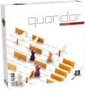
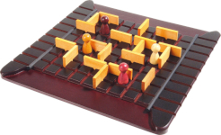
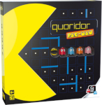
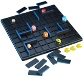

A31 - Projet "Quoridor"
=======================

   

À vous de développer une application mono-joueur du jeu de société "Quoridor" !

A - Consignes générales
-----------------------

### Pour constituer les équipes

- Le projet se fait **en binôme d'étudiants du même groupe TP**.
- En cas de nombre d'étudiants impair, vous pouvez constituer un monôme ou un trinôme.

Commencez par inscrire votre équipe dans ce fichier partagé : <https://seafile.unistra.fr/f/0d16d9c2a758472e973b/>.

### Pour démarrer avec le dépôt Git

1. **Créez un groupe `nom1-nom2`** où nom1 et nom2 sont les noms de famille des deux membres de l'équipe.
2. **Forkez** le dépôt <https://git.unistra.fr/a313/a31-quoridor> dans le groupe créé ci-dessus.
3. Ajoutez le responsable du module ET votre enseignant de TD/TP comme **Reporter** de votre dépôt

### Pour toute la durée du projet

- Vous devez concevoir avec UML et implémenter en Java le jeu de société "Quoridor", en respectant une **architecture MVC** et en proposant une **interface graphique en Swing**.
- Vous devez respecter les **principes de conception** et mettre en œuvre les **patrons de conception** vus en cours, **lorsque cela est pertinent**. Attention, il ne s'agit pas d'essayer d'utiliser tous les patrons de conception vus en cours !
- Il est possible que vous soyez amenés à **renoncer à une partie du développement par manque de temps**. Dans ce cas, il faudra le signaler dans le rapport final (Exemple : "il aurait fallu faire *ceci* mais nous n’avions pas assez de temps et avons préféré nous concentrer sur *cela* parce que ...").
- Votre dépôt devra être **mis à jour au minimum une fois par semaine** de façon à ce que nous puissions évaluer votre progression sur toute la durée du projet.

B - Les règles du jeu
---------------------

Elles sont disponibles :

- en version textuelle : [ReglesDuJeu-Quoridor.pdf](./reglesDuJeu/RegleDuJeu-Quoridor.pdf).
- en vidéo : <https://www.youtube.com/watch?v=cwsZZGmiFQM>.

Pour le mode de jeu Pacman :

- en version textuelle : [ReglesDuJeu-QuoridorPacman.pdf](./reglesDuJeu/RegleDuJeu-QuoridorPacman.pdf).
- en vidéo : <https://www.youtube.com/watch?v=cwsZZGmiFQM&t=163s>

Vous pouvez y **jouer en ligne** sur <https://playquor.org/>.

### Materiel

Ce jeu de société comporte :

- **1 plateau de jeu de 9x9 cases**,
- **1 pion par joueur**,
- **20 murs**

Pour le mode de jeu Pacman, il y a en plus :

- **1 Pacman**
- **4 Pac-gommes**

C - Les fonctionnalités de base
-------------------------------

Vous devez modéliser et implémenter les fonctionalités ci-dessous pour **2 joueurs humains**.

### C1 - Génération de la grille

- Niveau 1 : taille fixe de 9x9 (règles officielles)
- Niveau 2 : taille paramétrable de 9x9 ou 11x11

### C2 - Choix du nombre de murs

- Niveau 1 : nombre fixe de 10 murs par joueur (règles officielles)
- Niveau 2 : possibilité de choisir entre 8, 10 ou 12 murs par joueur

### C3 - Placement des murs

- Niveau 1 : N'importe où
- Niveau 2 : Empêcher le placement d'un mur sur un autre mur
- Niveau 3 : Empêcher le placement des murs qui bloquent l'adversaire

### C4 - Déplacement des pions

- Niveau 1 : Permettre tous les déplacements sur une case adjacente libre
- Niveau 2 : Empêcher de franchir un mur
- Niveau 3 : Gérer les sauts au-dessus d'un joueur

### C5 - Détection de la fin de partie

Lorsqu'un joueur a atteint le bord opposé à son départ

### C6 - Possibilité de recommencer une partie à la fin d'une partie

- Niveau 1 : Pas de possibilité de recommencer
- Niveau 2 : Possibilité de recommencer sans redémarrer l'application

> ***Fortement recommandé** : Faites une conception UML qui tient compte de tous les niveaux mais implémentez d'abord le jeu avec tous les niveaux 1 avant d'implémenter les autres niveaux.*

D - Version 4 joueurs
---------------------

Proposer une version à **4 joueurs humains**. Il n'y a pas de joueur-ordinateur dans cette configuration.

### D1 - Mêmes fonctionnalités qu'à 2 joueurs

- Niveau 1 : Certaines fonctionalités de la version 2 joueurs fonctionnent
- Niveau 2 : Toutes les fonctionnalités de la version 2 joueurs fonctionnent

E - Version Pacman
------------------

### E1 - Placement des murs

- Niveau 1 : Placement fixe des 6 murs
- Niveau 2 : Placement aléatoire des 6 murs
- Niveau 3 : Placement manuel des 6 murs

### E2 - Déplacement de Pacman

- Niveau 1 : Avance de 2 cases
- Niveau 2 : Avance de 3 cases s'il mange une pac-gomme

### E3 - Déplacement des fantômes

- Niveau 1 : Avance de 1 case tout le temps
- Niveau 2 : Avance de 2 cases s'il a Pacman en ligne de mire

### E4 - Pacman mange un fantôme

- Niveau 0 : Il ne se passe rien
- Niveau 1 : Il est éliminé

### E5 - Un fantôme mange Pacman

- Niveau 0 : Pacman perd une vie
- Niveau 1 : Pacman perd une vie et le plateau est ré-initialisé
- Niveau 2 : Pacman perd une vie et le plateau est ré-initialisé sauf les Pac-gommes

### E6 - Condition de victoire

- Niveau 0 : Pas de condition de victoire
- Niveau 1 : Victoire de Pacman s'il mange toutes les Pac-gommes
- Niveau 2 : Niveau 1 + Victoire des fantômes si Pacman n'a plus de vies

Bonus - Joueur ordinateur
-------------------------

Proposer de **jouer en mode 2 joueurs, à 1 humain vs. 1 ordinateur**.

### Bonus1 - Choix de l'ordinateur entre déplacement et placement d'un mur

- Niveau 1 : Choix aléatoire
- Niveau 2 : Reproduire le choix du joueur humain
- Niveau 3 : Choix basé sur une stratégie non aléatoire

### Bonus2 - Placement des murs par l'ordinateur

- Niveau 1 : Placement fixe (suite des emplacements codée "en dur")
- Niveau 2 : Placement aléatoire
- Niveau 3 : Placement en suivant une stratégie pour bloquer le joueur humain

### Bonus3 - Déplacements de l'ordinateur

- Niveau 1 : Déplacementsd aléatoires
- Niveau 2 : Déplacement en essayant d'abord d'aller vers l'avant
- Niveau 3 : Déplacement en se dirigeant vers le chemin le plus court

G - L'interface graphique
-------------------------

Votre application doit proposer 4 écrans :

- un **écran de configuration** pour choisir les paramètres de la partie,
- un **écran principal** qui permet de jouer une partie,
- un **écran de fin de partie**.

### G1 - Écran de configuration

Il doit permettre de choisir :

- la taille de la grille
- le nombre de murs de par joueur
- le mode de jeu (classique ou Pacman)
- le nombre de joueurs si mode classique
- si on joue contre l'ordinateur si mode de jeu classique en version 2 joueurs

Un bouton doit permettre de passer à l'écran de placement.

### G2 - Écran de placement

Il doit être proposé lorsqu'on est en mode Pacman avec :

- un placement fixe intial (celui des [règles du jeu](./reglesDuJeu/RegleDuJeu-QuoridorPacman.pdf))
- un bouton pour générer un nouveau placement aléatoire (si niveau 2 de la [fonctionnalité F1](#f1-placement-des-murs))
- une façon ergonomique de placer ses différents bateaux (si niveau 3 de la [fonctionnalité F1](#f1-placement-des-murs))

Un bouton doit permettre de démarrer la partie et passer à l'écran principal.

### G3 - Écran principal

L'écran principal doit afficher :

- le plateau de jeu
- pour chaque joueur :
  - le nombre de murs qu'il a placé et qu'il luji reste à placer
  - le nombre de déplacements qu'il a fait
- en mode Pacman :
  - le nombre de vie restantes à Pacman
  - le nombre de Pac-gommes mangées par Pacman

**Le plateau doit permettre de visualiser** :

- les emplacements des cases et des murs
- les pions des joueurs
- si un mur est présent ou non
- qui est le joueur actif
- pour la version Pacman :
  - si le pion est Pacman ou un fantôme
  - si la case contient une Pac-gomme

À son tour, **le joueur humain doit pouvoir réaliser les actions suivantes** :

- cliquer sur l'emplacement d'une case libre pour y déplacer le pion actif
- cliquer sur l'emplacement d'un mur libre pour en poser un

Le **tour de l'ordinateur** doit être visualisé de façon ergonomique : le joueur humain doit se rendre compte que l'ordinateur a joué et comprendre quelle action il a effectué.

### G4 - Écran de fin de partie

Si la fin de partie est détectée, cet écran doit s'afficher et :

- annonce le vainqueur
- dans le mode Pacman :
  - indiquer le score de Pacman (nombre de Pac-gommes mangées)
  - indiquer le score des fantômes (nombre de fois où ils ont mangé Pacman)
- proposer de recommencer la partie (si fonctionnalité [C6](#c6-la-possibilité-de-recommencer-une-partie-a-la-fin-dune-partie))

Les rendus
----------

### 1er rendu

Date limite : le dimanche **22/11 à 23h59**

Documents :

- le **diagramme de classes** UML
  - le package `model` doit être décrit en anticipant tout le développement
  - les packages `controller` et `view` doivent proposer une version de base avec les classes minimales mais peuvent être incomplets
- le **code source**
- un **rapport** pour expliquer vos choix de conception

Le rendu est à faire sur votre dépôt Git **sur une branche nommée `rendu1`**.

### 2ème rendu

Date limite : le dimanche **20/12 à 23h59**

Documents :

- le **diagramme de classes** UML qui doit :
  - représenter l'intégralité de votre application
  - être entièrement cohérent avec le code
- le **code source**
- un **mode d'emploi** nommé `INSTALL.md` à la racine de votre projet, qui explique comment compiler, installer et lancer votre application
- un **rapport** pour présenter vos nouveaux choix de conception depuis le 1er rendu et expliquer les raisons des évolutions des choix de conception qui avaient été annoncés au 1er rendu.

Le rendu est à faire sur votre dépôt Git **sur une branche nommé `rendu2`**.

### Précisions

- Vos diagrammes UML doivent être au format PlantUML,
- À la fin du projet, votre dépôt devra contenir au minimum une branche `rendu1` et une branche `rendu2`. Ce seront les seules branches évaluées. Vous êtes libre de gérer le reste de votre dépôt comme vous le souhaitez.
