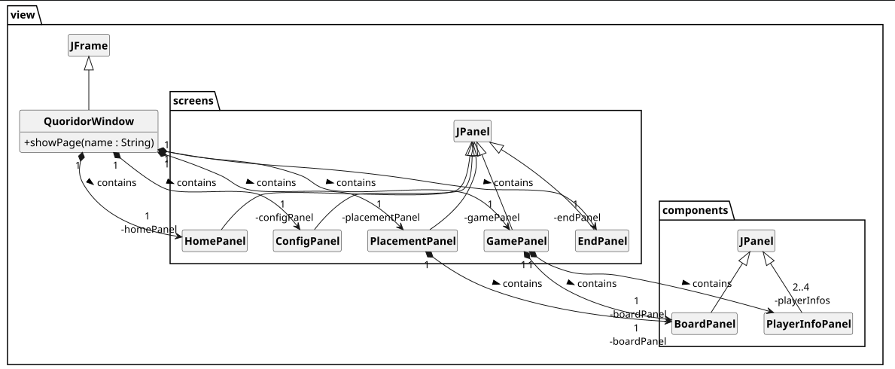
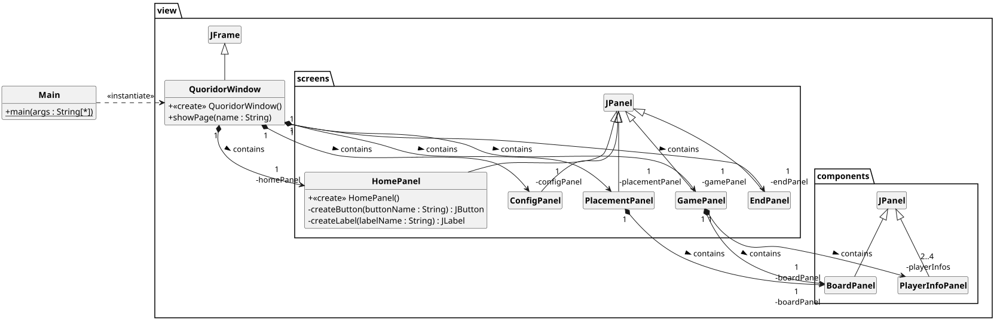
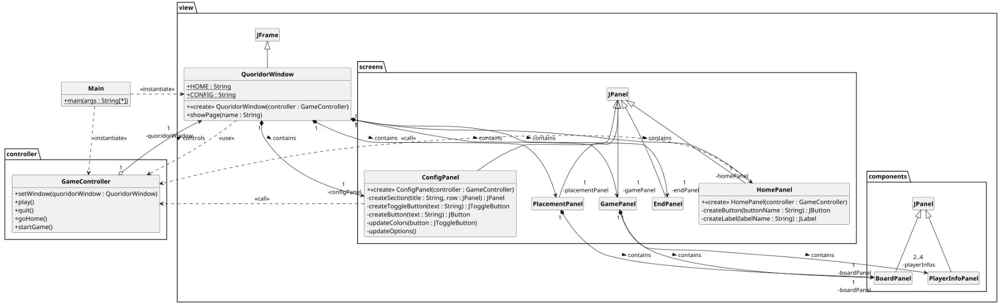
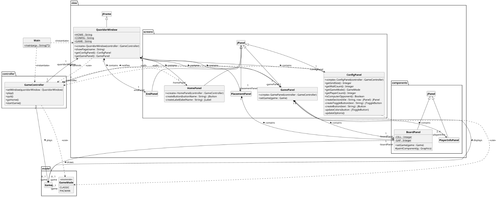
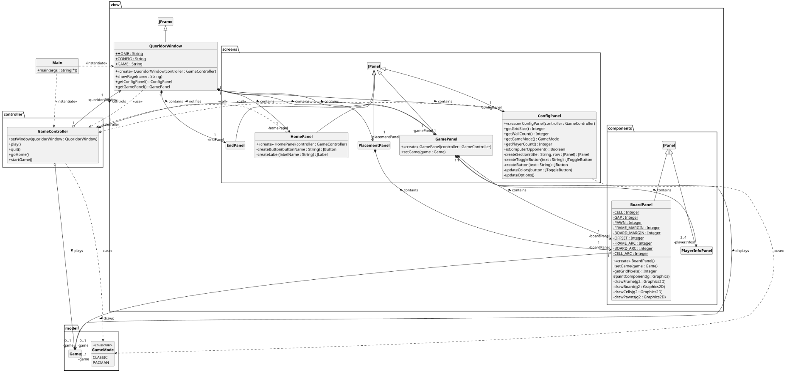
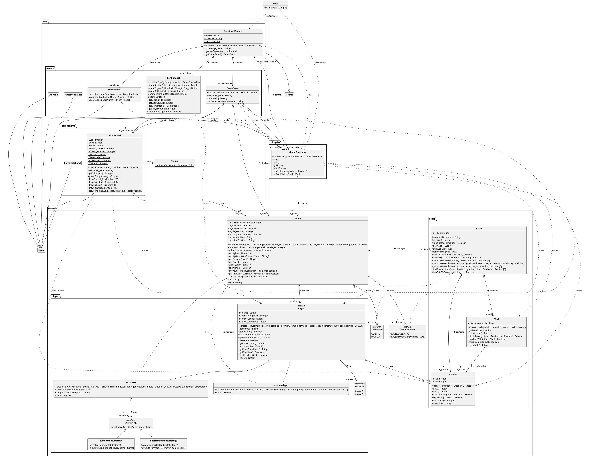

## Rapport du rendu 1

**Binôme :** Maxime Peignier, Alexis Danrée  
**Projet :** A31 Quoridor 

### 1. Introduction

Ce projet consiste à réaliser le jeu de société Quoridor en Java, avec une interface graphique en Swing et une architecture MVC. À terme, l'application doit proposer le mode classique à deux ou quatre joueurs, une partie contre l'ordinateur et une variante Pacman.

Nous nous sommes réparti le travail par couche : Alexis s'occupe du modèle, c'est-à-dire des données et des règles du jeu, et Maxime s'occupe de la vue et du contrôleur, c'est-à-dire de l'interface et du lien entre l'interface et le modèle. Chacun travaille sur sa propre branche Git (`alexis` et `maxime`), et nous récupérons régulièrement le travail de l'autre pour vérifier que les deux parties fonctionnent ensemble.

À ce stade, une partie peut être configurée puis jouée, à deux ou à quatre joueurs : un clic sur une case déplace le pion du joueur actif, et la victoire est détectée, même si elle n'est pour l'instant affichée que dans la console. Le choix de l'ordinateur comme adversaire est transmis au modèle, mais aucun joueur-ordinateur n'est encore créé. Il manque encore la pose des murs par un clic, les fiches des joueurs, l'écran de fin de partie et le mode Pacman.

Pour chacun de nous deux, ce rapport retrace l'évolution de la conception jour par jour, avec l'état du diagramme de classes à chaque étape.

### 2. Architecture générale

Le code est découpé en trois packages, conformément au patron MVC vu en cours.

Le package `model` contient les données et les règles du jeu. Il ne dépend pas de l'interface : il pourrait fonctionner avec une autre interface que Swing sans être modifié. Le package `view` contient la fenêtre et les pages Swing : il affiche l'état du jeu et transmet les actions de l'utilisateur. Le package `controller` fait le lien entre les deux : il reçoit les actions de la vue, modifie le modèle en conséquence et choisit l'écran à afficher.

Les dépendances vont toujours dans le même sens. La vue connaît le contrôleur, pour le prévenir d'un clic, et peut lire le modèle pour l'afficher, mais ne le modifie jamais. Le contrôleur connaît la vue, pour changer d'écran, et le modèle, pour le modifier. Le modèle ne connaît ni la vue ni le contrôleur : il prévient ses observateurs quand son état change, grâce au patron Observer.

La classe `Main`, à la racine du projet, assemble l'application : elle crée le contrôleur, puis la fenêtre, et relie les deux. La partie, elle, n'est créée qu'au moment où le joueur valide la configuration.

### 3. Les choix de conception d'Alexis

<!-- Partie rédigée par Alexis -->
Pour représenter les murs, nous avons fait le choix d'utiliser un Set d'objets Wall plutôt que des tableaux pour représenter les cases. Ce choix présente deux avantages majeurs : il évite d'allouer un tableau pour le remplir de Null et évite les erreurs de désynchronisation des tableaux (où il faudrait mettre à jour manuellement deux cases à chaque pose de mur) et il s'adapte à la taille de la grille sans plus de code. Le seul défaut est le parcours du set pour vérifier si un mur est présent ou non lors d'un déplacement.
 

### 4. Les choix de conception de Maxime

> 09/11/2026 :  Mise en place du projet

La première séance a été consacrée à l'organisation du dépôt, avant toute conception. Nous avons créé le groupe GitLab `peignier-danree`, forké le dépôt du sujet dans ce groupe et ajouté l'enseignant comme **Reporter**. Le dépôt est privé, pour que les autres équipes ne puissent pas consulter notre code.

Nous avons ensuite mis en place une structure commune avant d'écrire du code, pour éviter que chacun organise ses fichiers différemment. Le code source est placé dans `src/quoridor`, avec dès le départ les trois packages `model`, `view` et `controller`, pour imposer la séparation MVC. Les diagrammes PlantUML sont rangés dans `uml/` et la documentation dans `docs/`. Les fichiers fournis avec le sujet (énoncé, images, règles du jeu) ont été déplacés dans `docs/subject/`, pour garder la racine du projet lisible tout en conservant le sujet à portée de main.

Nous avons enfin ajouté un fichier `.gitignore` qui exclut les fichiers compilés (`out/`, `*.class`) et la configuration personnelle d'IntelliJ (`.idea/`, `*.iml`). Ces fichiers sont propres à chaque machine : les partager aurait provoqué des conflits à chaque compilation et des chemins invalides chez l'autre membre du binôme. Nous avons également choisi d'écrire le code, les commentaires et les messages de commit en anglais, pour rester cohérents tout au long du projet.

> 10/11/2026 : Organisation de l'UML et première version de la vue

Avant d'écrire le code de l'interface, nous avons réfléchi ensemble à la représentation de la grille, car elle conditionne à la fois le modèle et l'affichage. La difficulté vient des murs : ils ne se posent pas sur une case, mais entre les cases, et couvrent toujours deux cases. Nous avons retenu une grille de cases pour les pions, et des murs repérés par un point d'ancrage situé à l'intersection de quatre cases, associé à une orientation (horizontale ou verticale). Cette représentation suit directement les règles du jeu, où un mur se pose « entre deux blocs de deux cases », et fonctionne de la même façon pour une grille de 9×9 ou de 11×11.

Nous avons ensuite organisé le diagramme de classes en quatre fichiers PlantUML : un par package (`model.puml`, `view.puml`, `controller.puml`) et un fichier global qui les inclut. Comme Alexis travaille sur le modèle et moi sur la vue et le contrôleur, chacun peut modifier son fichier sans créer de conflit Git avec l'autre, et le fichier global reste le diagramme complet à rendre.

Pour l'interface, j'ai choisi d'utiliser une seule fenêtre, `QuoridorWindow`, plutôt qu'une fenêtre par écran. Ouvrir une nouvelle fenêtre à chaque changement d'écran l'aurait fait changer de place et de taille, et aurait obligé à fermer les anciennes. La fenêtre contient donc toutes les pages, empilées dans un `CardLayout`, qui n'en affiche qu'une à la fois. Changer d'écran se fait alors en une seule ligne, avec la méthode `showPage`.

Chaque écran demandé par le sujet est une classe à part, qui hérite de `JPanel` : l'accueil (`HomePanel`), la configuration (`ConfigPanel`), le placement des murs du mode Pacman (`PlacementPanel`), le jeu (`GamePanel`) et la fin de partie (`EndPanel`). J'ai regroupé ces pages dans un sous-package `screens`. Les éléments destinés à être réutilisés sont placés dans un sous-package `components` : le plateau (`BoardPanel`), qui apparaîtra à la fois sur l'écran de jeu et sur l'écran de placement, et la fiche d'un joueur (`PlayerInfoPanel`), que l'écran de jeu affichera une fois par joueur.

Ce jour-là, nous avons aussi exploré plusieurs directions artistiques pour l'interface, avant de retenir une ambiance « bois et feutre » inspirée du plateau de jeu réel.

> 11/11/2026 : Page d'accueil

Ce jour-là, j'ai réalisé la page d'accueil, qui contient le titre du jeu et deux boutons, « Jouer » et « Quitter ». Pour centrer ces éléments et les empiler verticalement, j'ai utilisé un `GridBagLayout`, qui place chaque composant dans une ligne d'une grille invisible et centre l'ensemble dans la page. Les marges entre les éléments sont réglées pour chaque composant, ce qui permet par exemple de séparer davantage le titre des boutons.

Plutôt que de régler le style de chaque bouton un par un, j'ai écrit une méthode `createButton`, qui crée un bouton et lui applique toute la mise en forme : couleurs, taille, police, suppression du style par défaut de Swing et curseur en forme de main. Une méthode `createLabel` fait de même pour le titre. Le style n'est ainsi écrit qu'une seule fois, conformément au principe DRY : tous les boutons ont la même taille quel que soit leur texte, et il suffit de modifier une méthode pour changer l'apparence de tous les boutons de la page. J'ai aussi ajouté un effet de survol, grâce à un `MouseAdapter` qui éclaircit la couleur du bouton lorsque la souris passe dessus.

Les couleurs de la page sont définies dans des constantes (`BACKGROUND`, `PRIMARY`, `PRIMARY_HOVER`) placées en haut de la classe, pour pouvoir changer la palette à un seul endroit. J'ai d'abord essayé une palette bleue, avant de revenir le lendemain à l'ambiance bois retenue au départ.

J'ai enfin mis à jour le diagramme de classes pour qu'il corresponde au code : ajout des constructeurs et des méthodes de `HomePanel`. J'ai aussi ajouté la classe `Main` dans le diagramme global, car elle n'appartient à aucun des trois packages : elle se trouve à la racine du projet et crée la fenêtre au lancement de l'application. Elle est reliée à la fenêtre par une dépendance de création, et non par une composition, car elle ne garde pas de référence vers la fenêtre.

> 12/11/2026 : Contrôleur et écran de configuration

Pour que les boutons de l'accueil aient un effet, j'ai créé le contrôleur, `GameController`. Dans l'architecture MVC, ce n'est pas à la vue de décider ce qui se passe après un clic : elle se contente de prévenir le contrôleur, qui choisit l'action à effectuer. Les boutons de `HomePanel` appellent donc simplement les méthodes `play()` et `quit()` du contrôleur, grâce à des `ActionListener` écrits sous forme de lambdas. Ainsi, si l'on veut un jour modifier le comportement d'un bouton, par exemple demander une confirmation avant de quitter, seul le contrôleur devra être changé. J'ai choisi un seul contrôleur pour toute l'application, car elle reste de taille modeste : plusieurs contrôleurs auraient compliqué le code sans réel bénéfice (principe KISS).

Le contrôleur et la fenêtre ont besoin l'un de l'autre : la fenêtre doit transmettre le contrôleur à ses pages, et le contrôleur doit pouvoir demander à la fenêtre de changer de page. Comme les deux ne peuvent pas être créés en même temps, `Main` crée d'abord le contrôleur, puis la fenêtre en lui donnant le contrôleur dans son constructeur, et enfin donne la fenêtre au contrôleur grâce à la méthode `setWindow`. C'est une forme d'injection de dépendance : aucune des deux classes ne crée elle-même l'objet dont elle a besoin.

Pour changer de page, le contrôleur appelle `showPage` avec le nom de la page voulue. Ces noms sont définis une seule fois, dans des constantes publiques de la fenêtre (`HOME`, `CONFIG`). Si un nom était écrit à la main à plusieurs endroits, une faute de frappe empêcherait silencieusement l'affichage de la page. Avec une constante, l'erreur est signalée dès la compilation.

J'ai ensuite réalisé l'écran de configuration, qui permet de choisir le mode de jeu, la taille de la grille, le nombre de murs par joueur, le nombre de joueurs et l'adversaire. Un `JButton` ne reste pas sélectionné après un clic, j'ai donc utilisé des `JToggleButton`, regroupés dans des `ButtonGroup` pour qu'un seul choix soit possible par section. Chaque section est construite de la même façon, avec un titre au-dessus d'une ligne de boutons, grâce à une méthode `createSection`. Les lignes utilisent un `GridLayout`, qui partage la largeur à parts égales entre les boutons : deux boutons prennent chacun la moitié de la ligne, et trois boutons un tiers chacun, tout en gardant la même largeur totale pour toutes les sections.

Le style des boutons de choix suit leur état, avec trois cas gérés par la méthode `updateColors` : rouge brique lorsqu'il est sélectionné, crème lorsqu'il ne l'est pas, et beige pâle lorsqu'il est désactivé. Pour retirer la couleur bleue que Swing applique par défaut au clic, j'ai désactivé le dessin du fond par Swing (`setContentAreaFilled(false)`) et je laisse uniquement nos propres couleurs.

Certaines combinaisons d'options n'ont pas de sens, et doivent donc être impossibles à choisir. En mode Pacman, la grille est fixée à 9×9, car le placement officiel des murs et des pac-gommes est prévu pour cette taille, et les choix des murs, du nombre de joueurs et de l'adversaire sont désactivés, car les règles de ce mode ne les utilisent pas : les murs y sont fixes et posés avant la partie. En mode classique à quatre joueurs, l'ordinateur est désactivé, car le sujet ne prévoit pas de joueur-ordinateur dans cette configuration. Avec Alexis, nous avons d'abord envisagé un écouteur différent pour chaque bouton, chacun grisant ou dégrisant certaines options. Mais l'adversaire dépend à la fois du mode et du nombre de joueurs, et cette approche obligeait à répéter les mêmes vérifications à plusieurs endroits. J'ai donc regroupé toutes ces règles dans une seule méthode, `updateOptions`, appelée à chaque changement de mode ou de nombre de joueurs. Elle recalcule l'état de toute la page à partir des choix actuels, ce qui garantit un résultat cohérent quel que soit l'ordre des clics.

Enfin, je suis passé à la palette « bois et feutre » choisie au départ, et j'ai ajouté les boutons « Retour » et « Lancer la partie », reliés aux méthodes `goHome()` et `startGame()` du contrôleur.

> 17/11/2026 : Récupération du modèle et création de la partie

À partir de ce jour, nous avons chacun travaillé sur notre propre branche Git, `maxime` et `alexis`. Pour pouvoir relier l'interface au modèle, j'ai récupéré le travail d'Alexis en fusionnant sa branche dans la mienne (`git merge origin/alexis`). Comme nous travaillons sur des packages différents, la fusion s'est faite sans conflit, et sa branche ainsi que la branche principale sont restées inchangées. J'ai ensuite étudié les classes publiques du modèle dont l'interface a besoin : `Game`, qui crée la partie et permet de jouer un coup, et l'interface `GameObserver`, que la vue implémentera pour être prévenue des changements.

La première étape a été de transmettre les choix de l'écran de configuration au contrôleur. J'ai ajouté à `ConfigPanel` une méthode publique par information : `getGridSize()`, `getWallCount()`, `getGameMode()`, `getPlayerCount()` et `isComputerOpponent()`. La méthode `getGameMode()` renvoie directement une valeur de l'énumération `GameMode` du modèle plutôt qu'une chaîne de caractères. C'est le type qu'attend le constructeur de `Game`, et une faute de frappe dans une chaîne n'aurait été détectée qu'à l'exécution. Le cas du mode Pacman est traité à part : comme les boutons de murs et de joueurs y sont tous désélectionnés, ces méthodes testent d'abord le mode pour renvoyer une valeur cohérente, par exemple zéro mur par joueur, puisque les murs de ce mode sont fixes.

Le contrôleur ne connaît que la fenêtre, et non les pages qu'elle contient. Pour lire ces choix, il demande donc la page de configuration à la fenêtre, grâce à la méthode `getConfigPanel()`. Dans `startGame()`, il récupère les cinq valeurs, crée la partie avec le constructeur de `Game`, puis affiche l'écran de jeu. La partie est stockée dans un attribut du contrôleur, et non dans une variable locale, car le contrôleur en aura besoin plus tard dans d'autres méthodes, par exemple pour transmettre au modèle un déplacement demandé par un clic. Le nombre de joueurs et le choix de l'ordinateur sont déjà lus, mais ne sont pas encore transmis au modèle, dont le constructeur ne gère pour l'instant qu'une partie à deux joueurs humains.

J'ai ensuite créé la page de jeu, `GamePanel`, et la constante `GAME` correspondante. Cette page a besoin de la partie pour l'afficher, mais elle est créée au lancement de l'application, alors que la partie n'existe qu'après la validation de la configuration. La partie ne peut donc pas être passée au constructeur de la page. Comme pour la fenêtre et le contrôleur, je l'ai transmise après coup, grâce à une méthode `setGame`, que le contrôleur appelle juste avant d'afficher l'écran de jeu. J'ai vérifié ce fonctionnement en affichant temporairement la taille du plateau sur la page.

Enfin, j'ai commencé le composant `BoardPanel`, qui dessine le plateau. Il reçoit lui aussi la partie par une méthode `setGame`, et lit la taille de la grille directement dans le modèle, avec `game.getBoard().getSize()`, et non dans l'écran de configuration. Une fois la partie créée, c'est en effet le modèle qui fait référence : l'écran de configuration n'est qu'un formulaire, utilisé une seule fois pour créer la partie. Le plateau ne dépend ainsi que du modèle, ce qui lui permettra d'être réutilisé sur l'écran de placement du mode Pacman.

> 18/11/2026 : Dessin du plateau et des pions

Avant de dessiner le plateau, j'ai réfléchi avec Alexis à la façon dont l'interface gérera la pose des murs. J'ai choisi de séparer les cases par des couloirs vides : ces couloirs correspondent exactement aux emplacements des murs du modèle. Un clic pourra ainsi être converti en coordonnées de la grille par une division entière par la taille d'une case et d'un couloir. Le reste de cette division indiquera si le clic vise une case, donc un déplacement, ou un couloir, donc un mur. Dans tous les cas, la vue se contentera de traduire le clic : c'est le modèle qui vérifiera si le coup respecte les règles.

Le plateau est dessiné dans `BoardPanel`, en redéfinissant la méthode `paintComponent`, que Swing appelle chaque fois que le composant doit être affiché. Le dessin se fait par couches, du fond vers le dessus : le cadre en bois foncé, puis le plateau en bois moyen, puis les cases, puis les pions. Chaque couche a sa propre méthode (`drawFrame`, `drawBoard`, `drawCells`, `drawPawns`), ce qui rend `paintComponent` lisible et permettra d'ajouter facilement le dessin des murs. Les coins sont arrondis grâce à `fillRoundRect`, et j'ai activé l'anticrénelage de `Graphics2D` pour lisser les courbes. Comme je dessine moi-même tout le fond, le panneau est déclaré non opaque, pour que Swing ne peigne pas un fond rectangulaire derrière les coins arrondis.

La grille est décalée par rapport au bord du panneau de l'épaisseur du cadre et de la marge du plateau. Ce décalage est défini dans une seule constante, `OFFSET`, car il sera utilisé à la fois pour dessiner les cases, les pions et les murs, et pour convertir les clics en coordonnées. Toutes les dimensions (taille d'une case, d'un couloir, des marges, des arrondis) sont également des constantes, pour pouvoir ajuster l'apparence du plateau à un seul endroit. Le calcul de la taille de la grille en pixels, utilisé à plusieurs endroits, est regroupé dans une méthode `getGridPixels()` (principe DRY).

La taille du panneau dépend de la taille de la grille, 9×9 ou 11×11, qui n'est connue qu'à la réception de la partie. C'est donc dans `setGame` que le plateau calcule sa taille préférée, puis demande à Swing de recalculer la mise en page (`revalidate()`) et de le redessiner (`repaint()`).

Pour les pions, le plateau parcourt la liste des joueurs du modèle et dessine un cercle au centre de la case de chacun. La couleur de chaque joueur est choisie dans un tableau de couleurs, selon sa place dans la liste. Ce tableau contient déjà quatre couleurs, pour que la future version à quatre joueurs fonctionne sans modifier le dessin.

Enfin, l'écran de jeu affiche maintenant ce plateau à la place du texte de test, et lui transmet la partie dans sa propre méthode `setGame`. La prochaine étape sera de détecter les clics sur le plateau, puis de brancher l'écran de jeu sur le modèle grâce à l'interface `GameObserver`, pour qu'il se redessine après chaque coup.

> 19/11/2026 - 21/11/2026 : Clics, observateur et fusion avec le modèle

Pour pouvoir jouer, j'ai d'abord rendu le plateau sensible aux clics, grâce à un `MouseAdapter` ajouté dans le constructeur de `BoardPanel`. Comme prévu le 18/11, la méthode `getCellAt` convertit la position du clic, en pixels, en une case de la grille : elle retire d'abord le décalage `OFFSET`, puis effectue une division entière par `CELL + GAP`, la taille d'une case et d'un couloir. Le quotient donne la colonne et la ligne, et le reste indique si le clic est tombé sur une case ou dans un couloir. Si le clic vise une case, le plateau appelle la méthode `onCellClicked` du contrôleur, qui demande au modèle de déplacer le pion du joueur actif. La vue se contente donc de traduire le clic : c'est le modèle qui vérifie si le déplacement respecte les règles.

Il fallait ensuite que le plateau se redessine après chaque coup. J'ai pour cela utilisé le patron Observer : `GamePanel` implémente l'interface `GameObserver` du modèle, et le contrôleur l'abonne à la partie dans `startGame`, avec `addObserver`. Après un déplacement valide, le modèle prévient ses observateurs avec `onBoardUpdated()`, et l'écran de jeu redessine le plateau. Le contrôleur n'a ainsi jamais besoin de demander à la vue de se rafraîchir : il modifie le modèle, et c'est le modèle qui prévient la vue. La fin de partie suit le même chemin, avec `onGameOver`, qui affiche pour l'instant le nom du gagnant dans la console.

J'ai ensuite fusionné la nouvelle version du modèle d'Alexis, dont le constructeur de `Game` accepte maintenant le nombre de joueurs et le choix de l'ordinateur. La méthode `startGame` transmet donc enfin ces deux valeurs, lues dans l'écran de configuration depuis le 17/11. La partie à quatre joueurs a fonctionné sans modifier le dessin, grâce aux quatre couleurs prévues le 18/11.

Les couleurs des pions étaient jusqu'ici rangées dans `BoardPanel`. Je les ai déplacées dans une classe séparée, `Theme`, avec une méthode statique `getPawnColor`, car les futures fiches des joueurs devront afficher la même couleur que le pion de chaque joueur. Ces couleurs ne sont ainsi écrites qu'à un seul endroit (principe DRY).

Avec Alexis, nous avons aussi adopté une convention commune pour les attributs : leur nom commence par le préfixe `m_`, par exemple `m_game` ou `m_boardPanel`. Ce préfixe distingue au premier coup d'œil un attribut d'un paramètre ou d'une variable locale, ce qui évite par exemple de confondre, dans `setGame`, l'attribut `m_game` et le paramètre `game`. Alexis l'utilisait déjà dans le modèle, et je l'ai appliqué à la vue et au contrôleur pour que tout le projet suive la même règle.

J'ai également aligné le diagramme de classes sur le code. Chaque fichier ne décrit plus que son propre package, et toutes les relations entre packages sont regroupées dans le diagramme global. J'ai retiré les relations qui n'existaient pas encore dans le code, par exemple les fiches des joueurs contenues dans l'écran de jeu : elles reviendront au rendu 2, lorsque ces classes seront réalisées.

Enfin, en testant la partie à quatre joueurs, j'ai remarqué que les joueurs 3 et 4 ne pouvaient pas gagner. La méthode `checkVictory` ne testait que l'axe vertical, alors que ces deux joueurs doivent atteindre une colonne, et non une ligne. Je l'ai corrigée, en accord avec Alexis, en utilisant la méthode `hasReachedGoal()` du joueur, qui tient compte de son axe d'arrivée.

### 5. Conclusion

Ce premier rendu nous a surtout permis de poser des bases solides. Le dépôt est organisé, le découpage MVC est en place dès la structure des packages, et chacun de nous peut travailler sur sa partie sans bloquer l'autre, grâce aux branches Git et aux diagrammes séparés par package. Le modèle et l'interface sont maintenant reliés : on peut configurer une partie, puis la jouer à deux ou à quatre joueurs en cliquant sur les cases, jusqu'à la victoire de l'un d'eux.

Plusieurs choix faits au début nous ont déjà fait gagner du temps : la représentation des murs par un point d'ancrage, commune au modèle et à la vue, le regroupement des noms de pages et des dimensions dans des constantes, et les petites méthodes de création de composants, qui évitent de répéter le même code. Nous avons aussi appris à revenir sur nos choix lorsqu'ils posaient problème, par exemple en regroupant toutes les règles de l'écran de configuration dans une seule méthode, ou en corrigeant notre diagramme de classes pour respecter les conventions UML vues en cours.

Pour le rendu 2, il reste à terminer le jeu. Côté interface, il faudra transformer un clic dans un couloir en pose de mur et dessiner les murs, puis réaliser les fiches des joueurs et l'écran de fin de partie, avec la possibilité de rejouer. Côté modèle, il faudra gérer les sauts par-dessus un pion, le joueur ordinateur et ses stratégies, puis la variante Pacman avec son écran de placement des murs. Pour l'instant, un pion peut se déplacer sur une case déjà occupée : nous corrigerons ce problème en même temps que les sauts. Nous compléterons enfin le diagramme de classes pour qu'il corresponde entièrement au code final.

